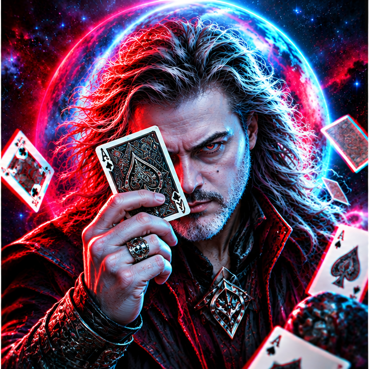

<!-- GitHub profile README for github.com/lordbasex; image stored in assets/lordbasex.png -->

  

  <h1>Federico Pereira <code>LordBaseX</code></h1>
  
<strong>Open Source Architect · GNU/Linux Engineer · Applied AI & Automation · Cloud / DevOps · VoIP</strong>

  
<em>From the Linux shell to AI-powered systems — building serious technology since 2000.</em>

  

    
    
    
  

  

    
    
  

**🌐 Read this profile in:**  
**🇬🇧 English** &nbsp;·&nbsp; [🇪🇸 Español](README.es.md) &nbsp;·&nbsp; [🇧🇷 Português](README.pt.md)

---

## 👨‍💻 About me

I’m **Federico Pereira**, known online as **LordBaseX**. I’m an open-source developer, infrastructure architect and **Technical Director at [CNSoluciones](https://www.cnsoluciones.com/nosotros/)**, based in Argentina. I’ve been working with **GNU/Linux since 2000**, helping organizations build secure, scalable and maintainable systems.

Today I focus on **advanced applied AI**, AI agents, LLM-powered integrations, workflow automation, software engineering, distributed systems and enterprise infrastructure. My work spans low-level Linux components, real-time communications and production cloud deployments.

**Philosophy:** Open standards, privacy, pragmatism, automation and technology that creates measurable value. My consultancy specializes in enterprise solutions rather than Windows or basic PC support.

## 🏆 Highlights & milestones

- **Since 2000:** building and engineering with GNU/Linux and open-source ecosystems.
- **DebPBX:** contributed to the OpenTecnologic team behind the DebPBX Linux distribution, as documented by CNSoluciones.
- **LordOS:** building a Debian-based distribution with its own C-based Wayland compositor, React/QuickJS interface and privacy-focused native applications.
- **Applied AI:** integrating intelligent workflows, AI-assisted solutions, agents and automation into business processes.
- **Open-source portfolio:** projects spanning macOS audio/translation, WebRTC remote access, classic gaming, networking and infrastructure.

## 🚀 Featured open-source projects

### [🐧 LordOS](https://github.com/lordbasex/LordOS)

A Debian-based GNU/Linux distribution with its own desktop, C/Wayland compositor, React/QuickJS UI engine and privacy-first native apps.

Debian · C · Wayland · React · QuickJS

### [🎧 MacDub](https://github.com/lordbasex/macdub)

Real-time offline dubbing for macOS: capture audio, transcribe, translate and play speech locally using native Apple technologies.

Swift · macOS · Offline speech & translation

### [🕹️ go-link Console](https://github.com/lordbasex/go-link-console)

Multiplayer classic arcade gaming from a browser: MAME/libretro host with video, audio and voice streamed over WebRTC.

Go · React · WebRTC · MAME / libretro

### [🖥️ go-link Desk](https://github.com/lordbasex/go-link-desk)

Browser-based remote desktop using WebRTC — portable host application, no client installation required for viewers.

Go · WebRTC · Remote desktop

### [📡 SignalHub](https://github.com/lordbasex/signalhub)

WebRTC signaling server in Go with device pairing, rooms, invitations and short-lived TURN credentials.

Go · WebRTC · TURN

### [AI agents | SentinelDesk](https://github.com/lordbasex/sentineldesk)

A collaborative operating environment for people and AI agents, bringing AI-assisted work into one desktop-like workspace.

AI agents · Collaborative workspace · Open Source

### More projects from my repositories

| Area | Repository | What it does |
| --- | --- | --- |
| WebRTC ecosystem | [go-link](https://github.com/lordbasex/go-link) | Multilingual landing hub for the go-link application family |
| IoT / Go | [HomeKitGenQRCode](https://github.com/lordbasex/HomeKitGenQRCode) | Print-ready HomeKit QR code labels for ESP32 accessories |
| macOS / hardware | [OpenCore EFI - Z590](https://github.com/lordbasex/EFI-GIGABYTE-Z590-AORUS-ELITE-i9-10900K) | Documented OpenCore EFI configuration for a Gigabyte Z590 system |

**[Browse the complete public repository catalog](REPOSITORIES.md)** · **[View live repositories on GitHub](https://github.com/lordbasex?tab=repositories)**

The catalog is generated from GitHub's API after its workflow runs and refreshes automatically. The highlighted projects above are curated, not a complete inventory.

## 🛠️ Technology stack

### AI & Intelligent Automation

     

### Systems, Languages & App Development

         

### Infrastructure, DevOps & Networking

       

### Communications & Unified PBX

    

### Databases

 

### Cloud Platforms

       

## 🤝 Let’s build something useful

Open-source collaboration, consulting, architecture, Linux infrastructure, enterprise VoIP and applied AI.

**🌐 [Consulting & services](https://www.cnsoluciones.com/nosotros/)** · **✉️ [Contact CNSoluciones](https://www.cnsoluciones.com/contacto/)** · **💻 [GitHub profile](https://github.com/lordbasex)**

<strong>🌎 Quick introduction in Spanish and Portuguese</strong>

**🇪🇸 Español**

Soy Federico Pereira (LordBaseX), especialista en GNU/Linux desde 2000, arquitecto Open Source y Director Técnico de CNSoluciones. Desarrollo soluciones de IA aplicada, automatización, infraestructura, cloud, VoIP y proyectos como LordOS.

**🇧🇷 Português**

Sou Federico Pereira (LordBaseX), especialista em GNU/Linux desde 2000, arquiteto Open Source e Diretor Técnico da CNSoluciones. Desenvolvo soluções de IA aplicada, automação, infraestrutura, nuvem, VoIP e projetos como o LordOS.

---

The badges above describe technologies I work with; they are not vendor certifications. Native GitHub achievements appear automatically on my GitHub profile.

<i>Made with open-source curiosity, from Argentina 🇦🇷</i>

